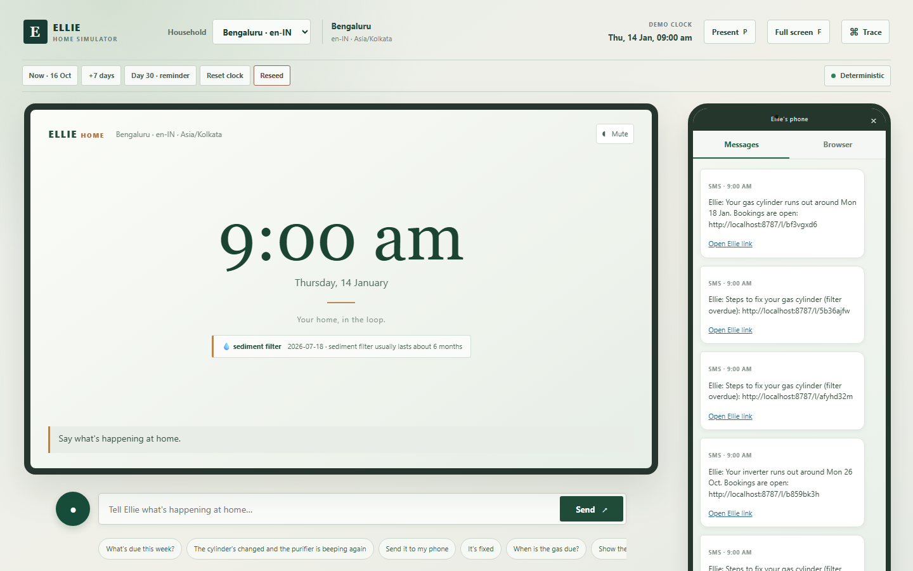
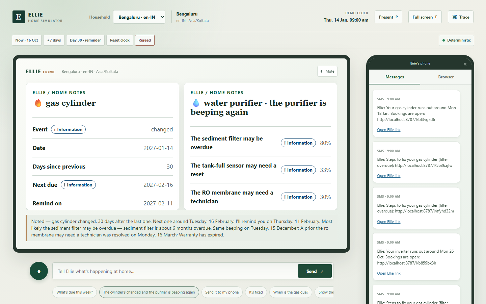
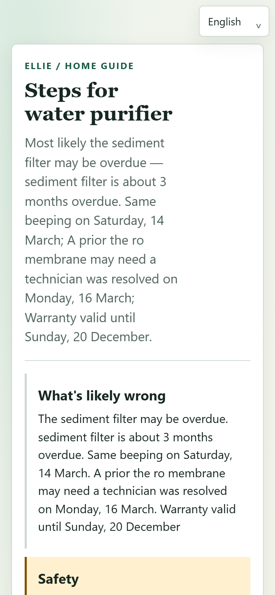
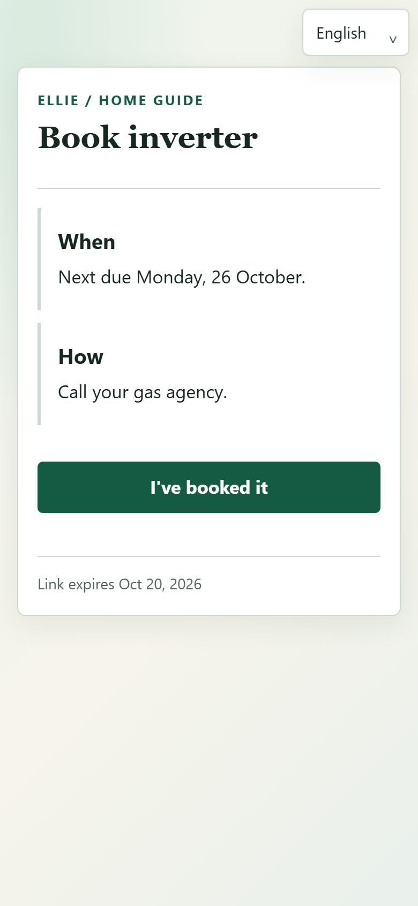
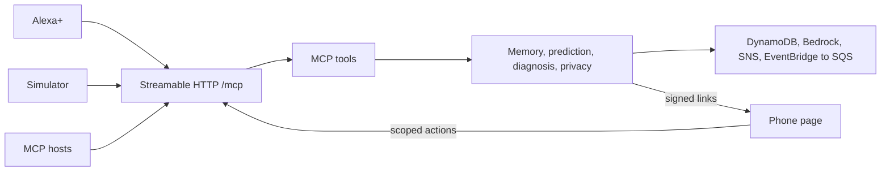

# Headsup

**Normal reminders remember a time. Headsup remembers your home.** Headsup is an MCP household memory agent that turns home history into predictions, cited diagnosis, and useful phone handoffs.

<!-- 👤 Replace this paragraph with your own household moment, in your own words. One true incident. No statistics. -->
> *The moment that started this.* <!-- for example: the Saturday the cooking gas ran out mid-meal, two days after I'd told myself I should order a refill. -->

**What Alexa+ already does.** Set a reminder for a date you choose, and tell you when it's due.

**What it can't do.** Know that *your* cylinder lasts 27 days rather than 30 because that's what your last six refills show. Know that your region needs a booking lead time. Remember that the purifier did this before and what fixed it.

**What Headsup adds.** A household memory that learns from your own events, applies sourced regional rules, diagnoses from your own repair history with cited evidence, and hands the long version to your phone.

- Remembers appliances, supplies, maintenance, and household events.
- Predicts what is due from household history and sourced regional packs.
- Diagnoses problems with cited evidence, safety stops, and a one-question-at-a-time flow, then hands longer guidance to a phone.

Five surfaces, one server: the Echo Show card, the phone page, the Alexa+ simulator, the MCP App view, and the privacy views.

Honest scope: the Alexa+ MCP Toolkit is [available in the United States](https://developer.amazon.com/docs/alexaplus/add-ons/mcp-toolkit-overview.html) and limited to selected partners, so the demo runs on the bundled simulator. It is labelled a simulator everywhere it appears. The MCP server underneath is real — see [docs/audit/inspector-evidence.md](docs/audit/inspector-evidence.md) and the [conformance table](docs/DEPLOY.md#alexa-connection-you).

Building this surfaced real platform friction, logged in [docs/friction-log.md](docs/friction-log.md) — including a requirement where Alexa+ and RFC 9728 disagree about 401 responses.

## Screenshots

| Simulated Echo Show | Two tools in one sentence |
| --- | --- |
|  |  |

| Fix guide on the phone | Booking reminder on the phone |
| --- | --- |
|  |  |

Regenerate them with `npx playwright install chromium`, then `npm run screenshots` while Headsup is running.

## Demo in 60 Seconds

Requires Node.js 20 or newer; Node 22 LTS is recommended.

```powershell
npm install
npm run build
npm run seed:reset
npm run dev
```

Open `http://127.0.0.1:8787/sim/` and press `P` to start Presenter mode. Use **Speak now** or the deterministic **Use chip** fallback. Press `F` for the recording layout. To verify the complete journey headlessly, keep the server running and run `npm run demo:check` in another terminal.

### Reproducing the scripted demo exactly

`npm run seed:reset` anchors the seed to **today**, so everyday runs always look current. The recorded demo and `demo/script.json` are written against a fixed day, so a judge reproducing them must pin both the seed anchor and the clock:

```powershell
$env:SEED_ANCHOR_DATE = "2026-10-16"      # anchor the seeded history
npm run seed:reset                         # rebuild the two demo households
$env:ELLIE_FAKE_NOW = "2026-10-16T09:00:00+05:30"   # 09:00 in Asia/Kolkata
npm start                                  # or: npm run dev
npm run demo:check                         # 15/15 against the running server
```

To start over at any point, run `npm run seed:reset` again; to clear the demo clock, call `ellie_dev_time_travel` with `reset: true`, or restart without `ELLIE_FAKE_NOW`. Presenter mode's **Reset clock** and **Reseed** buttons do the same from the browser. Deleting `data/ellie-store.json` before reseeding gives a completely clean store.

## Architecture



## MCP Tools

| Tool                    | Purpose                                          | Annotation                         |
| ----------------------- | ------------------------------------------------ | ---------------------------------- |
| `ellie_ping`            | Check that Headsup is responding                   | Read-only                          |
| `ellie_status`          | Inspect active drivers and health                | Read-only                          |
| `ellie_region_info`     | Explain a region-pack item or rule               | Read-only                          |
| `setup_household`       | Save household preferences and consented contact | Writes data                        |
| `log_event`             | Record a home event                              | Writes data                        |
| `get_history`           | Read events for a household or item              | Read-only                          |
| `predict_next`          | Estimate the next due date                       | Read-only with recomputation       |
| `due_this_week`         | Brief the household on upcoming work             | Read-only                          |
| `ellie_dev_time_travel` | Advance the development clock                    | Development-only write             |
| `diagnose`              | Assess a problem using evidence and safety rules | Writes a diagnosis session         |
| `log_resolution`        | Record a confirmed fix                           | Writes data                        |
| `send_to_phone`         | Send a consented phone handoff                   | External side effect               |
| `what_do_you_know`      | Show the privacy inventory                       | Read-only                          |
| `manage_consent`        | Check, grant, or withdraw message consent        | Consent change                     |
| `forget_item`           | Plan and confirm erasure of one item             | Destructive; confirmation required |
| `forget_household`      | Plan and confirm household erasure               | Destructive; spoken code required  |

## Journeys

- **First change:** log an event; Headsup can ask one follow-up and then update its prediction.
- **Diagnosis from history:** report a symptom; Headsup ranks cited evidence and applies safety checks before guidance.
- **Phone and booking:** send fix steps, record a fix, then use a reminder link to book with the region provider.
- **Privacy:** review what is stored, export JSON, withdraw consent, forget one item, or erase the household.

## Region Packs

The `@ellie/schema` package provides browser-safe contracts, matching, date helpers, catalogs, and DEFAULT, IN, US, and UK packs. It is the monorepo source of truth; regenerate the standalone project with `npm run schema:extract -- --out ../home-event-schema` for each release. The planned public repository is [home-event-schema](https://github.com/merlinbaptista/home-event-schema); it still needs to be created and pushed by the maintainer.

Run `npm run validate:packs` to validate structure. The verification report is [docs/pack-verification.md](docs/pack-verification.md). Do not treat a `verified: false` fact as an official rule.

## Drivers and Go-Live

All services run in mock mode when no AWS configuration is present. AWS mode uses DynamoDB, Bedrock, SNS, and EventBridge Scheduler to SQS.

| Service   | AWS configuration                                                | Mock implementation  |
| --------- | ---------------------------------------------------------------- | -------------------- |
| Storage   | `AWS_REGION`, `DYNAMODB_TABLE_NAME`, AWS credentials             | File or memory store |
| LLM       | `AWS_REGION`, `BEDROCK_MODEL_ID`, AWS credentials                | Mock LLM             |
| Notifier  | `AWS_REGION`, topic or direct SMS configuration, AWS credentials | Console outbox       |
| Scheduler | `AWS_REGION`, target, role, queue, AWS credentials               | Local timer          |

See [docs/API_SETUP.md](docs/API_SETUP.md) for per-service setup, costs, verify commands, fallbacks and teardown, and [docs/DEPLOY.md](docs/DEPLOY.md) for Docker, tunnel, AWS and the Alexa+ conformance table. The user must choose the public tunnel, AWS region/model, and external connector steps.

Two commands answer "is this configured?" without ever printing a secret:

```powershell
npm run keys:check     # per service: CONFIGURED / MISSING / MALFORMED
npm run aws:check      # per service: PASS / FAIL / SKIPPED, with cause and fix
```

## Safety and Privacy

Gas, electrical, carbon monoxide, and water-near-power hazards stop DIY guidance and use regional emergency details. Privacy tools require confirmation for deletion; consent is checked centrally and contact values are masked in logs and exports. See [docs/PRIVACY.md](docs/PRIVACY.md).

## Quality

Latest workspace tests: schema 26, server 151, UI 6, phone 19, simulator 15 (217 total). The Module 10 mock benchmark ran 30 samples after 3 warm-ups; all seven measured tools had p95 below 500 ms. Workspace totals are updated in [docs/modules.md](docs/modules.md); `npm run demo:check` passed all 15 steps repeatedly against the mock server.

| Tool               | p50 (ms) | p95 (ms) | max (ms) |
| ------------------ | -------: | -------: | -------: |
| `due_this_week`    |        5 |        6 |        7 |
| `predict_next`     |        4 |        6 |        6 |
| `get_history`      |        4 |        6 |        6 |
| `log_event`        |        3 |        5 |        6 |
| `diagnose`         |       73 |       94 |      106 |
| `send_to_phone`    |        3 |        5 |        5 |
| `what_do_you_know` |        4 |        7 |        7 |

## Limitations

- Region packs still contain starter defaults; 59 are reported by aggregate validation, with inherited DEFAULT facts counted in multiple resolved packs. Human decisions and official sources are pending in [docs/pack-verification.md](docs/pack-verification.md).
- Hindi, Kannada, Tamil, and Spanish labels remain starter translations and need native-speaker review; use English for the demo unless reviewed.
- AWS live deployment and Bedrock/SNS/EventBridge delivery have not been verified in this environment. SNS SMS sandbox and India DLT requirements may apply.
- Alexa+ connector instructions and real-device rehearsal must follow the official connector documentation; the simulator remains the verified demo path.
- **Docker files are provided, not tested on this machine.** Docker is not installed in this environment, so `Dockerfile`, `docker-compose.yml` and `npm run docker:up` have never been built or run here. Treat them as untested.
- The public tunnel and the GitHub schema repository require maintainer-run setup steps.

## License

MIT. See [LICENSE](LICENSE).
